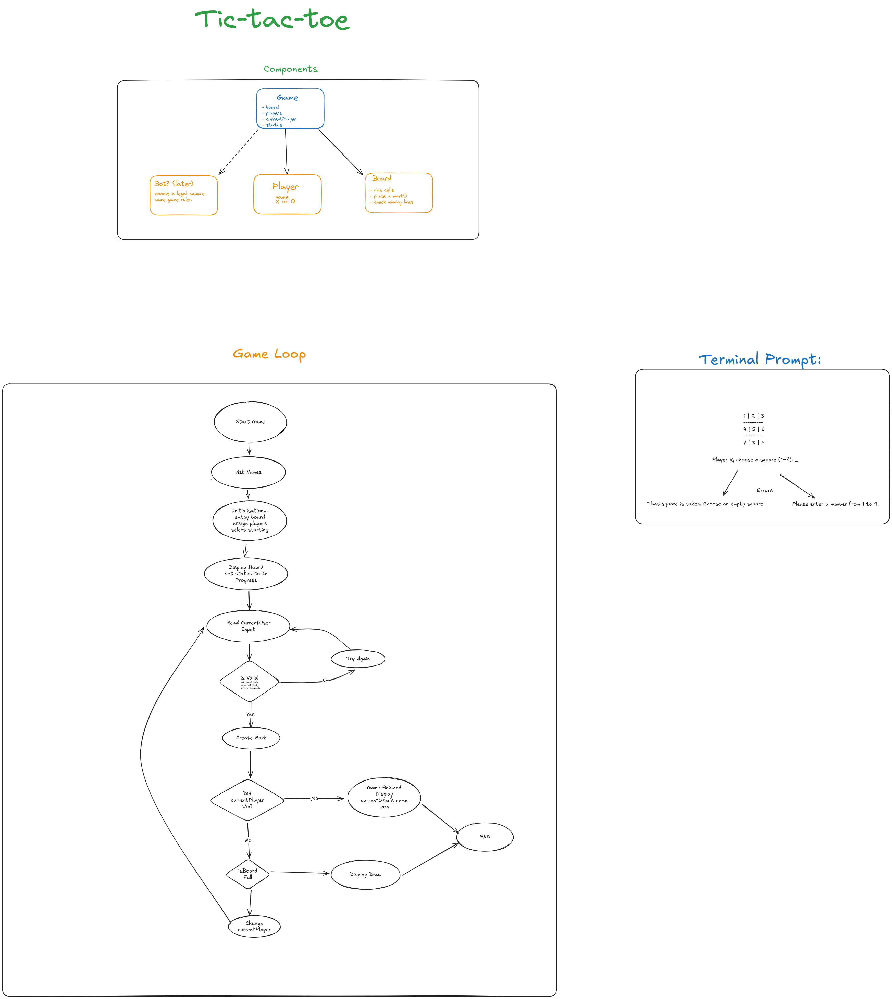
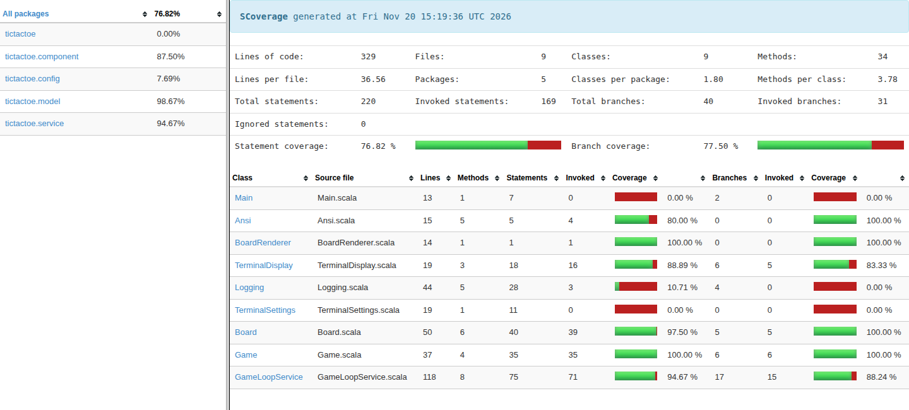

# Tic-tac-toe

[Github Repository](https://github.com/liamattard/tic-tac-toe)

Here you can find my submission for the tic-tac-toe interview assignment.

This is a two-player terminal game written in Scala 2.13. I chose Scala 2.13
because it is the version I use at work. I will go through my code/design choices of the game.

I also built an optional browser version using the same Scala game logic. I deployed this via a container on Railway using a small Scala web server. You can [try it here](https://tic-tac-toe-production-5d713f35.up.railway.app/) or view the code on [feature/web-ui](https://github.com/liamattard/tic-tac-toe/tree/feature/web-ui).

## How I built the game using Test-Driven Development

I started with Excalidraw drawings and Markdown plans to think through:

1. The objects of the game.
2. The game loop itself.

Then I built the game in small steps using the red–green–refactor cycle:

1. Write a failing test for the next behaviour.
2. Add enough code to make it pass.
3. Refactor where needed, then run the tests again to check the behaviour still works.

For example, board placement needed to update the chosen cell while leaving the
original board unchanged. I also tested rejected moves, such as placing a mark
on an occupied square, before moving on to turn management and game outcomes.
You can see these cases in [BoardSuite](src/test/scala/tictactoe/model/BoardSuite.scala).

I started with the board, then built up to turns, wins, draws and finally the
terminal loop. For the loop, I supplied scripted input and captured the output
so I could test a full match, invalid input and early exits without typing each
move manually.

This helped me focus on one behaviour at a time and gave me a way to check that
later changes had not broken the rules already implemented.

## The code

The main object behind the game is [Game](src/main/scala/tictactoe/model/Game.scala).
It holds:

1. A [Board](src/main/scala/tictactoe/model/Board.scala), containing the nine cells.
2. Two [players](src/main/scala/tictactoe/model/Player.scala), each with a name and mark.
3. An index identifying whose turn it is.

A `Player` just contains the name and mark (X/O).

`Game` handles turns and rejects moves after the match has finished.

`Board` handles placing marks and checking winning lines. The game status is calculated
from the board.

[GameLoopService](src/main/scala/tictactoe/service/GameLoopService.scala) handles the terminal flow: ask for names, display the board, read a move and show the result. [Main](src/main/scala/tictactoe/Main.scala) sets up logging and terminal options, then starts the loop.

- `model`: immutable game state. Invalid moves return `Either` rather than throwing exceptions.
- `component`: board rendering and terminal display.
- `service`: player input and the game loop.
- `config`: terminal options and file logging.

The scope is a standard 3×3 board with two local human players.

## Design choices

I wanted to keep the rules small and separate from how the game is played.

- **Immutable state:** placing a mark returns a new board and game. The previous state stays unchanged.
  > [!NOTE]
  > I used immutable state for two reasons: it makes testing easier, and it keeps the move flow clear. A valid move returns `Right` with a new game; a rejected move returns `Left` with an error, leaving the current game unchanged.  This creates new objects, but for a 3×3 board the cost is very small.

- **Factory methods:** `Game.start` and `Board.empty` create the initial state; their constructors are private.
- **Dependency injection:** the terminal loop accepts read/write functions, so tests can play a match without a real terminal.
- **Sealed types and pattern matching:** `Mark`, `GameStatus` and `MoveError` describe the possible values explicitly.

The board is a flat `Vector[Option[Mark]]`: `None` means an empty square.
`Game.status` is derived from the board, so there is no separate status field to keep in sync.

## Running the Game

You need JDK 17 and sbt.

```sh
sbt run
```

Enter the players' names, or leave them blank for Player X and Player O.
Colours and screen clearing are enabled by default. For plain output:

```sh
sbt "run --plain"
```

## Run with Docker

Build the JAR locally, then package it in a Java 17 runtime image:

```sh
sbt clean test assembly
docker build -t tictactoe .
docker run --rm -it tictactoe
```

You need JDK 17, sbt and Docker for these steps. The resulting image only needs
Java to run and uses a non-root user. Add `--plain` after `tictactoe` if needed.

You can also run the built JAR directly:

```sh
java -jar target/scala-2.13/tictactoe.jar
```


## Error handling

An occupied square is an expected outcome, so `play` returns
`Either[MoveError, Game]`. A rejected move keeps the same board and player's turn;
the terminal loop turns the error into a readable message and asks again.
Invalid numbers are handled with `toIntOption`, and end of input exits cleanly.

File logging uses `try/catch` for `NonFatal` failures. If logging cannot start,
the game shows a warning and continues; the handler is closed in `finally`.

## Logging

I kept logging separate from the terminal display so it does not interrupt the
game. Match starts and results are logged at `INFO`; accepted and rejected moves
at `FINE` (debug). Diagnostics go to `logs/tictactoe.log`, capped at about 1 MB.
The log file is excluded from Git.

## Game objects

Here is an example after X has played the first square. This is just a JSON-style
view of the Scala objects.

```json
{
  "board": { "cells": ["X", null, null, null, null, null, null, null, null] },
  "players": [
    { "name": "Liam", "mark": "X" },
    { "name": "Ġwanni", "mark": "O" }
  ],
  "currentPlayer": { "name": "Ġwanni", "mark": "O" },
  "status": "InProgress"
}
```

`currentPlayer` is looked up using an internal player index. The possible statuses
are `InProgress`, `Won(player)` and `Draw`.

## Planning

This is my early Excalidraw sketch of the objects and game loop. It includes a
possible bot for later; the submitted game has two human players.

<details>
<summary>Planning sketch</summary>

[](planning/planning.png)

The [editable drawing](planning/planning.excalidraw) and
[planning notes](planning/README.md) are also included.

</details>

## Tests and coverage

```sh
sbt test
sbt clean coverage test coverageReport
```

Open `target/scala-2.13/scoverage-report/index.html` to view coverage locally.
Tests cover the rules and scripted terminal sessions, including invalid input
and early exits. GitHub [Actions](https://github.com/liamattard/tic-tac-toe/actions)
also checks formatting, runs the tests, uploads the coverage report and checks
the Docker image with a scripted match.


The report below was generated on 20 November 2026: **76.82% statement coverage**
and **77.50% branch coverage**. This is a snapshot; the latest report is available
in GitHub Actions.



## Optional browser demo

[Play the browser version](https://tic-tac-toe-production-5d713f35.up.railway.app/).

The terminal application is the submission on `main`. I also added a small
HTML/CSS/JavaScript interface on [feature/web-ui](https://github.com/liamattard/tic-tac-toe/tree/feature/web-ui).
It calls a Scala HTTP server that uses the same game models and rules; it does
not use the terminal game loop. Two people play on the same screen, and games
are kept in memory, so they are lost when the server restarts.
